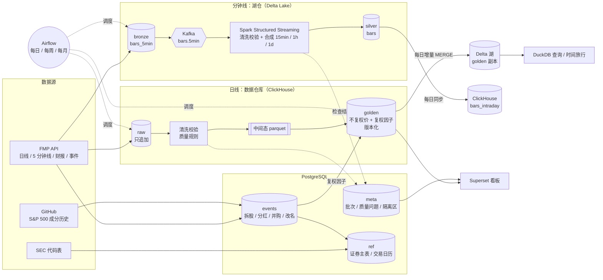

# Data Engine：美股量化数据平台

一个人从零搭建的美股数据平台：把付费数据源（FMP）和社区 / 官方数据（SEC、GitHub）整理成**可以放心拿来回测**的数据——
有唯一的证券编号、不复权价 + 自算复权因子、每条数据都有来源和质量记录、能按"当时知道什么"回看历史。

日线走**数据仓库**（ClickHouse），分钟线走**湖仓**（Delta Lake + Kafka + Spark），两条线共用一套质量规则和监控；
Airflow 每天自动运行，Superset 看板展示数据质量和管线运行情况。

| | |
|---|---|
| 股票池 | 2010 年以来进过 S&P 500 的 820 只证券（含已退市的，避免幸存者偏差） |
| 数据 | 日线 2010 至今 266 万行；财报、比率、市值、一致预期等 raw 合计 852 万行；公司事件 7.9 万条；5 分钟线每日增量 |
| 质量 | 81 条质量规则（规则即代码，19 个接口）；累计记录问题 6.1 万条、隔离 4,472 条 |
| 测试 | 358 个 pytest + Spark 端自检 |

---

## 架构



**为什么两条线**：日线数据量小、要和财报等一起做复杂清洗，放数据库最方便；分钟线量大、要被 Spark / DuckDB 等不同引擎读，
放开放表格式的湖里，数据库只当查询加速层。面试时可以对比着讲"数据仓库 vs 湖仓"。

---

## 技术栈

| 层 | 用了什么 | 用来做什么 |
|---|---|---|
| 调度 | Airflow 3.3（LocalExecutor） | 每日 / 每周 / 每月三个流程，重试、并行分支、失败提醒 |
| 存储 | ClickHouse 24.8 | raw / golden（列存，查询快） |
| | PostgreSQL 16 | 证券主表、交易日历、公司事件、质量元数据（要事务和约束） |
| | Delta Lake（delta-rs 1.6 / Delta Spark 3.3） | 湖仓：bronze / silver、golden 的开放副本、时间旅行 |
| 计算 | pandas | 拉取、清洗（日线量级单机足够） |
| | Spark 3.5 Structured Streaming | 分钟线流式清洗与合成 |
| | DuckDB 1.5 | 直接查湖里的 Delta 表（不用起服务） |
| 消息 | Kafka 3.9（KRaft） | 分钟线推送 |
| 可视化 | Superset 6.1 | 数据质量看板、管线运行看板（看板即代码） |
| 运行 | Docker Compose | 全部服务一键启动 |

---

## 核心设计

### 1. 证券主表：不靠代码识别证券
代码会改名（FB → META）、会被重复使用（WM、FB 都换过公司）。所有数据用自分配的 `security_id`，代码只是带有效期的属性
（`ref.security_identifiers`，[from, to) 区间，GiST 排除约束保证同一时刻一个代码只对应一个证券）。
主表由事件（改名、调入、退市）推导，每天增量维护。→ [`pipelines/security_master.py`](pipelines/security_master.py)

### 2. 不复权价 + 自算复权因子
FMP 的复权价会随新的拆股 / 分红**改写历史**。golden 只存不复权价，复权因子由拆股、分红、分拆事件自己算（CRSP 口径），
复权价用视图现算；FMP 复权价只用来交叉核对（按收益率比，不比价格）。→ [`docs/schemas/golden.price_daily.md`](docs/schemas/golden.price_daily.md)

### 3. 幂等：任何一步都能放心重跑
| 环节 | 怎么做到 |
|---|---|
| 拉取 | 按（接口, 参数）断点续跑，已写进 raw 的股票跳过 |
| 事件 | 按（来源, 事件键, 内容哈希）去重；内容变了记新修订；整理前全序排序（避免顺序不同产生假修订） |
| 清洗 | 按批次在一个事务里整体替换问题和隔离记录 |
| golden | 先比对，数值变了才写新版本 |
| 湖 | MERGE 按主键 + 版本号，没有变化不提交 |
| 流处理 | foreachBatch "至少一次" + 按主键 MERGE = 效果上"恰好一次" |

### 4. 按时点查询（防未来函数）
golden 只追加、带 `version` / `loaded_at`，事件带 `known_at`：可以回答"某一天我们知道的数据是什么"。
Delta 的时间旅行用于复现和排错（"昨天那次导出改了什么"）——两者是不同的时间，见 [`docs/lakehouse.md`](docs/lakehouse.md)。

### 5. 数据质量：规则即代码
每条规则（编号、版本、级别、参数）写在清洗类里，运行时同步到 `meta.quality_rules`，改参数必须升版本。
danger → 进隔离区、不进 golden；warning → 打标记。日线和分钟线（Spark 里检查）问题记在同一套表里。
噪音大的规则用"跳了又回来"、按波动率定阈值等方法降噪。→ [`clean/`](clean/)、[`spark_jobs/bar_rules.py`](spark_jobs/bar_rules.py)

### 6. 批流一体
分钟线的清洗、合成函数只写一份，流处理（每个微批）和批处理（从 bronze 重算）调用同一个；
核对任务逐行比对两边结果：首次跑通时 80 万行、0 不一致（含故意注入的 1% 重复、0.5% 迟到消息）。→ [`docs/streaming.md`](docs/streaming.md)

### 7. 运维：失败了能自己恢复、该叫人时才叫人
- 失败自动重试 4 次，间隔指数增长（10 → 60 分钟），能扛过两个多小时的断网
- 每日流程三条线（事件 / 日线 / 分钟线）并行，一条失败不挡另一条
- 汇总只把"重试后仍没补上"的失败标红；状态变化、股票池外的事件修订不提醒
- 排障记录见 [`docs/airflow.md`](docs/airflow.md)

---

## 目录

```
config/        接口配置（URL、单次行数上限、分段天数）、路径、人工修正 CSV
fetch_data/    拉取：FetchData（重试、限流、按日期分段、截断检测）；事件整理
clean/         每个接口一个清洗类（质量规则）
pipelines/     流程：raw_loader / clean_runner / golden_loader / daily / periodic / lakehouse / intraday …
spark_jobs/    Spark：分钟线清洗合成（流 / 批共用）、规则定义、自检
streaming/     Kafka 回放生产者
dags/          Airflow DAG：daily_eod / weekly_fundamentals / monthly_reference / healthcheck
db/            Postgres / ClickHouse / 对象存储读写
sql/           建表：postgres/（19 个迁移）、clickhouse/（19 个）
tools/         Superset 看板即代码、经代理拉镜像、湖仓演示
docker/        Airflow / Superset / Spark 镜像
docs/          设计文档、表结构说明
test/          pytest（358 个）
```

---

## 快速开始

```bash
cp .env.example .env               # 填 FMP_API_KEY、数据库密码等（.env 不进 git）
docker compose up -d               # Postgres、ClickHouse、Airflow、Superset、Kafka、Spark
# 建表：sql/postgres/*.sql、sql/clickhouse/*.sql 按编号执行

python -m pipelines.backfill       # 全量回填（可断点续跑）
python -m pipelines.golden_loader all
python -m pipelines.lakehouse export
python tools/superset_dashboards.py
```

| 网页 | 地址 |
|---|---|
| Airflow | http://localhost:8081 |
| Superset | http://localhost:8088 |
| Spark（流任务） | http://localhost:4040 |

演示：`python tools/lakehouse_demo.py AAPL`（DuckDB 查湖：现算复权价、版本历史、时间旅行）

---

## 文档

| 文档 | 内容 |
|---|---|
| [docs/airflow.md](docs/airflow.md) | 调度、幂等与重试、提醒规则、排障记录 |
| [docs/lakehouse.md](docs/lakehouse.md) | Delta 湖、增量 MERGE、时间旅行；Delta vs Iceberg |
| [docs/streaming.md](docs/streaming.md) | Kafka + Spark 分钟线：设计、清洗、批流核对结果 |
| [docs/superset.md](docs/superset.md) | 看板即代码、只读账号 |
| [docs/data-dictionary.md](docs/data-dictionary.md) | 全部表的说明；单表详见 `docs/schemas/` |

---

## 做过的取舍

- **不用 Hadoop / Flink**：数据量单机能处理；Spark 只用在分钟线（批流一体、按分区并行）
- **Airflow 用 LocalExecutor 不用 Celery**：单机部署，Celery 多一个消息队列和 worker，没有收益
- **查湖用 DuckDB 不用 Trino**：Trino 是 Java 服务、起步要几 GB 内存；DuckDB 嵌入式、零运维
- **分钟线只做 demo 深度**：FMP 套餐带宽每月 20 GB、没有 1 分钟线；只拉 2026-10 起的 5 分钟线，每天增量
- **财报暂不进 golden**：FMP 财报会覆盖重述前的旧值，要做到按时点准确需要接 SEC 原始申报数据，留作后续
